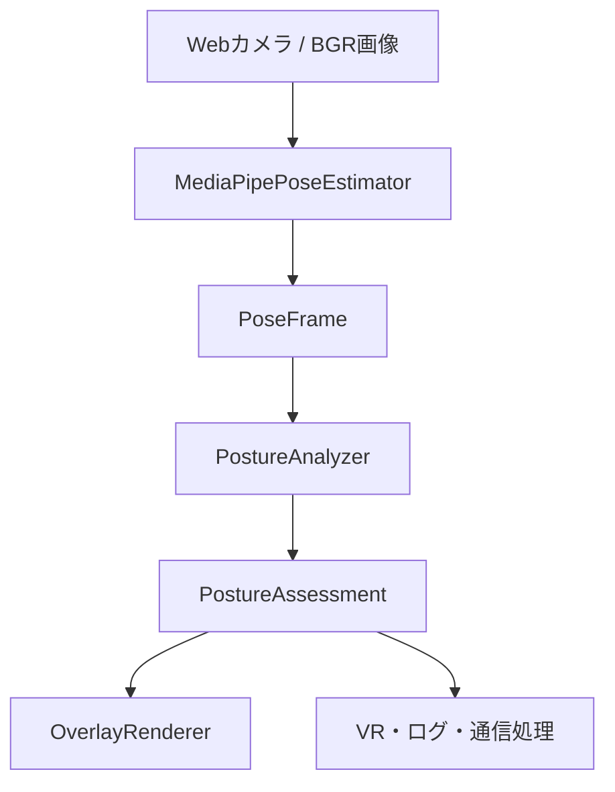

# pose_est

## 1. 目的

WebカメラのMediaPipe推定座標、またはRealSense D435iのaligned depthから復元したランドマークを使い、利用者ごとに登録した**食事時の基準姿勢**との差を判定するPythonコンポーネントである。

> **用途・安全性**: 本ソフトは食事時の着座姿勢への気づきを支援する試作システムであり、誤嚥の検知・予防効果、嚥下の安全性、足裏の接地を保証しない。顎引き・頭部回旋等の嚥下代償姿勢を画一的に指示しない。嚥下障害がある利用者の食事姿勢は医療専門職の個別評価を優先する。根拠と評価計画は [`docs/evidence_and_validation.md`](docs/evidence_and_validation.md) を参照。

D435iのWindows 11導入・配置・測定定義・未検証項目は [RGB-D手順](docs/realsense.md) を参照。

### クイックスタート

```bash
uv sync
uv run python scripts/download_model.py
uv run pose-est
# 任意の設定ファイルを指定する場合
uv run pose-est --config config.json
```

- **C**: 画面に頭・肩・腰を映し、無理なく保てる食事時の姿勢で基準を登録する
- **P**: 食べ物を口へ運ぶ・会話する・食事介助する間、判定と通知を停止／再開する
- **Q / Esc**: 終了する
- 食卓では脚が隠れやすいため、**足の判定は初期設定では無効**。両足が映る環境でのみ設定の `feet.enabled=true` にする
- カメラ位置、椅子、卓上環境を変えた場合は基準を再登録する。起動時は `baseline.json` が残っていれば再利用する

主な用途は次の2つの通り。

- OpenCVのカメラ映像上へ姿勢フィードバックを表示する
- 判定結果をPythonオブジェクトまたはJSONとしてVR処理、ロガー、通信処理などへ渡す

## 2. 対象範囲

### 判定するもの

- 頭部ピッチ：基準より見上げているか、下を向いているか
- 体幹前傾：肩と腰を結ぶ軸が基準より前後に倒れているか
- 頭部前方変位：耳が肩に対して基準より前後へ移動しているか
- 左右の足の位置と傾き：両方が基準から大きく変化したか
- 左右の足のぶらつき：時系列上で足位置が揺れ続けているか

### 判定しないもの

- 足裏が床や足台へ物理的に接触しているか
- 足へ体重を預けているか
- 誤嚥、咳や湿性嗄声、口腔内の食物、食事中の嚥下タイミング
- 脊柱の形状、骨盤角度、関節可動域などの医学的評価
- 完全に遮蔽された身体部位の推測
- 複数人の同時追跡

## 3. 構成



| ファイル | 責務 |
| --- | --- |
| `mediapipe_estimator.py` | BGR画像をMediaPipeへ渡し、`PoseFrame`へ変換する |
| `geometry.py` | ランドマークから判定用の幾何指標を計算する |
| `analyzer.py` | 平滑化、個人基準との差、時系列判定、状態遷移を処理する |
| `baseline.py` | キャリブレーションと個人基準の保存・読込を行う |
| `models.py` | 入出力データ構造を定義する |
| `overlay.py` | 骨格と判定結果を映像へ描画する |
| `app.py` | カメラ、推定器、判定器、描画器を接続する |

判定器はOpenCVのUIから独立している。別のカメラ入力、録画映像、ネットワーク経由のランドマークを使う場合も、`PoseFrame`へ変換すれば`PostureAnalyzer`を再利用できる。

## 4. 実行環境

- Python：3.12以上（`pyproject.toml` の依存関係に従う）
- 姿勢推定：MediaPipe Pose Landmarker、1人分
- 映像入力：OpenCVで取得可能なBGR画像
- 時刻：単調増加するミリ秒整数

事前にMediaPipeで使うモデルを落としておく。

```bash
uv run python scripts/download_model.py
```

パッケージとして実行する。

```bash
uv run pose-est --config config.json
# または
uv run python -m pose_est --config config.json
```

## 5. 公開インターフェース

パッケージ直下から公開する型は次のとおり。

```python
from pose_est import (
    AssessmentStatus,
    CameraPostureApp,
    FootAssessment,
    FootRule,
    MetricAssessment,
    MetricRule,
    Point3D,
    PoseFrame,
    PostureAnalyzer,
    PostureAssessment,
    PostureBaseline,
    PostureConfig,
)
```

### 5.1 カメラアプリを利用する

```python
from pose_est import CameraPostureApp, PostureConfig


def receive_result(result):
    if result.needs_feedback:
        # 低頻度の通知イベント。毎フレームの姿勢状態は result.metrics にある。
        print(result.feedback_messages)


config = PostureConfig.load("config.json")
CameraPostureApp(config).run(on_result=receive_result)
```

`on_result`は各フレームの判定後、表示前に同じスレッドで同期的に呼ばれる。コールバック内で長時間の通信や重い処理を行うと、カメラ処理のフレームレートが低下する。必要ならキューへ投入し、別スレッドまたは別プロセスで処理すること。

### 5.2 判定器だけを利用する

```python
import time

from pose_est import PostureAnalyzer, PostureConfig

config = PostureConfig.load("config.json")
analyzer = PostureAnalyzer(config)

timestamp_ms = time.monotonic_ns() // 1_000_000
analyzer.start_calibration(timestamp_ms)

# 各フレームで呼ぶ。poseはPoseFrameまたはNone。
result = analyzer.update(pose, timestamp_ms)
payload = result.to_dict()
```

`PostureAnalyzer`は履歴を保持するステートフルなオブジェクトである。1人・1映像ストリームにつき1インスタンスを使用し、複数スレッドから同時に呼ばないこと。`timestamp_ms`はフレーム順に単調増加させる。

## 6. 入力仕様

### 6.1 `PoseFrame`

```python
PoseFrame(
    image_landmarks: tuple[Point3D, ...],
    world_landmarks: tuple[Point3D, ...],
)
```

- `image_landmarks`：画像幅・高さで正規化された座標。骨格描画に使用する
- `world_landmarks`：MediaPipe互換の3次元座標。姿勢判定に使用する
- 両方ともMediaPipe Pose Landmarkerと同じ33点のインデックスを前提とする
- 人物を検出できなかったフレームは`None`を渡す

`Point3D`の各フィールドは次のとおりである。

| フィールド | 型 | 意味 |
| --- | --- | --- |
| `x`, `y`, `z` | `float` | 座標値 |
| `visibility` | `float` | 画面内で見えている信頼度。通常0～1 |
| `presence` | `float` | ランドマークが存在する信頼度。通常0～1 |

採用条件は`min(visibility, presence) >= visibility_threshold`である。

### 6.2 左右の定義

`left`と`right`は画面上の左右ではなく、撮影される本人の解剖学的な左右を表す。

`mirror_image=true`の場合も、反転するのは画面表示と描画用の画像座標だけである。MediaPipeへの入力、`world_landmarks`、判定結果は反転しない。

## 7. キャリブレーション仕様

判定は絶対的な理想姿勢ではなく、利用者が無理なく取れる望ましい姿勢を個人基準とする。

1. `start_calibration(timestamp_ms)`を呼ぶ。カメラアプリでは`C`キーに対応する。
2. 有効な全指標を`calibration_seconds`秒間収集する。
3. 各指標について`min_calibration_samples`件以上集まった場合に完了する。
4. 各指標の中央値を基準値として採用する。
5. `take_baseline_update()`が新しい`PostureBaseline`を1回だけ返す。

足判定を有効にした場合、左右の足に必要なランドマークもキャリブレーション中に見えている必要がある。どれか1指標でも必要サンプル数へ達しなければ、時間が経過しても完了しない。通常の食卓では `feet.enabled=false` を推奨する。

キャリブレーション中の`overall_status`は`calibrating`で、`calibration_progress`は0～1となる。進捗は経過時間と全指標の最小サンプル進捗の小さい方である。

## 8. 上半身の判定指標

計算には、鼻、耳、肩、腰のMediaPipe world landmarkを使う。左右すべてが見える場合は左右中点を使用し、片側しか十分に見えない場合は信頼度の高い側を使用する。頭部ピッチは鼻と耳が見えれば、腰が隠れていても計算できる。

| キー | 単位 | 正方向 | 概要 |
| --- | --- | --- | --- |
| `head_pitch_deg` | 度 | 見上げる方向 | 耳から鼻へのベクトルのピッチ角 |
| `torso_forward_deg` | 度 | 顔が向く方向への前傾 | 腰から肩への軸と鉛直方向の角度 |
| `head_forward_ratio` | 比率 | 顔が向く方向 | 肩に対する耳の前後変位を体幹長で正規化 |

現在値を`v`、基準値を`b`とすると、判定に使う差は`d = v - b`である。

- `d < lower_delta`：`below`
- `lower_delta <= d <= upper_delta`：`ok`
- `d > upper_delta`：`above`

`below`と`above`は外部出力ではどちらも`advice`になり、方向は`MetricAssessment.direction`で区別する。

各指標の現在値には指数移動平均を適用する。

```text
smoothed = smoothing_alpha * current
         + (1 - smoothing_alpha) * previous
```

## 9. 足の判定指標

左右それぞれについて、腰、膝、足首、かかと、つま先を使用する。

脚長の代理値を次のように定義する。

```text
leg_scale = distance(hip, knee) + distance(knee, ankle)
```

足中心と正規化足位置は次のとおりである。

```text
foot_center = (heel + toe) / 2
foot_position = (foot_center - hip) / leg_scale
```

基準位置との差は、単眼カメラで不安定になりやすい奥行き`z`を弱く評価する。

```text
position_deviation = sqrt(dx^2 + dy^2 + depth_weight * dz^2)
```

足の傾きは、かかとからつま先へのベクトルのピッチ角と基準角との差の絶対値である。

ぶらつきは、`motion_window_seconds`以内の足位置について、窓内平均からの重み付きRMSを計算する。次の両方を満たすまでは計算せず`unknown`とする。

- サンプル数が`min_window_samples`以上
- 履歴の時間幅が`motion_window_seconds`の60%以上

デフォルトの注意条件は次の論理式である。

```text
motion_bad OR (position_bad AND pitch_bad)
```

`require_position_and_pitch=false`の場合は次の条件になる。

```text
motion_bad OR position_bad OR pitch_bad
```

足の判定は接地そのものではなく、「基準位置付近で足裏方向が近く、継続的に揺れていない」ことを位置安定性の代理条件として扱う。基準位置付近で静止したまま足を浮かせた場合は区別できない。そのため**接地を促す断定的な文言は使わない**。

## 10. 時系列の状態確定

1フレームだけ閾値を超えても、即座には表示を切り替えない。

- 注意状態への遷移：同じ候補状態が`warn_hold_seconds`継続した後
- 正常状態への復帰：`ok`が`recover_hold_seconds`継続した後
- 観測不能への内部状態遷移：`unknown`が`unknown_hold_seconds`継続した後（ただし観測喪失時は古い `advice` を表示せず即座に `unknown` とする）

食事中の動作による短い姿勢変化を警告しないよう、標準の上半身 `warn_hold_seconds` は **2.5秒**。これは臨床的な閾値ではなく、使用感を調整するための暫定値である。

候補状態が途中で変わった場合、継続時間はリセットされる。このため、呼び出し直後や足の履歴収集中は一時的に`unknown`となる。

## 11. 出力仕様

### 11.1 全体状態

`PostureAssessment.overall_status`は次のいずれかである。

| 値 | 意味 |
| --- | --- |
| `not_calibrated` | 個人基準が設定されていない |
| `calibrating` | 個人基準を収集中 |
| `paused` | 利用者が手動で一時停止中 |
| `advice` | 1項目以上で姿勢調整が必要 |
| `unknown` | 注意項目はないが、1項目以上を観測できない |
| `ok` | 有効な全項目を観測でき、注意項目がない |

通常判定時の優先順位は`advice > unknown > ok`である。つまり、右足が見えず`unknown`でも、頭部に注意があれば全体は`advice`となる。

`needs_feedback`は**通知すべき新しいイベントが発生したフレームだけ**`True`となる。状態が `advice` の間も毎フレームは鳴らさない。通知文は `feedback_messages` に入り、同時に最大1件だけ発行される。`feedback_min_interval_seconds` 未満の再通知を避け、同じ項目の継続通知は `feedback_repeat_seconds` 以上空ける。通知の優先順位は体幹、頭部前方変位、頭部ピッチ、その他の指標、足の順。`messages` は現在の画面表示用で、すべての状態を継続取得したい場合は `overall_status` や `metrics` を使用する。

### 11.2 JSON互換データ

`to_dict()`は次の構造を返し、`to_json()`はそれをJSON文字列へ変換する。

```json
{
  "timestamp_ms": 123456,
  "overall_status": "advice",
  "calibrated": true,
  "metrics": {
    "head_pitch_deg": {
      "key": "head_pitch_deg",
      "status": "advice",
      "value": 17.2,
      "baseline": 5.1,
      "deviation": 12.1,
      "lower_delta": -15.0,
      "upper_delta": 8.0,
      "confidence": 0.91,
      "direction": "above",
      "message": "頭の向きを無理なく基準姿勢へ戻してください"
    }
  },
  "feet": {
    "left": {
      "side": "left",
      "status": "advice",
      "position_deviation_ratio": 0.08,
      "motion_rms_ratio": 0.05,
      "pitch_deviation_deg": 4.2,
      "confidence": 0.76,
      "reasons": ["motion"],
      "message": "左足の位置を確認してください"
    }
  },
  "messages": ["頭の向きを無理なく基準姿勢へ戻してください", "左足の位置を確認してください"],
  "calibration_progress": null,
  "feedback_messages": ["頭の向きを無理なく基準姿勢へ戻してください"]
}
```

観測できない値は`null`になる。無効化した上半身指標は`metrics`に含まれず、足判定を無効化した場合は`feet`が空になる。`reasons`には`motion`、`position`、`pitch`のうち、注意の根拠になったものだけが入る。

## 12. 設定仕様

### 12.1 全体設定

| キー | 既定値 | 意味 |
| --- | ---: | --- |
| `model_path` | `models/pose_landmarker_full.task` | MediaPipeモデルのパス |
| `baseline_path` | `baseline.json` | 個人基準の保存先 |
| `camera_index` | `0` | OpenCVのカメラインデックス |
| `frame_width` | `1280` | 要求する映像幅 |
| `frame_height` | `720` | 要求する映像高さ |
| `mirror_image` | `true` | 表示だけを鏡像化する |
| `visibility_threshold` | `0.55` | 上半身ランドマークの最低信頼度 |
| `smoothing_alpha` | `0.25` | 指数移動平均の係数 |
| `calibration_seconds` | `3.0` | 基準姿勢の最短収集時間 |
| `min_calibration_samples` | `30` | 各指標に必要な最低サンプル数 |
| `unknown_hold_seconds` | `0.3` | 観測不能を確定する継続時間 |
| `feedback_min_interval_seconds` | `10.0` | 通知全体の最短間隔（秒） |
| `feedback_repeat_seconds` | `35.0` | 同じ項目の再通知までの間隔（秒） |

### 12.2 上半身指標設定

`metrics`で指定できる現在のキーは`head_pitch_deg`、`torso_forward_deg`、`head_forward_ratio`である。設定へ任意のキーを追加しても、その指標を計算する実装が`geometry.py`になければ常に`unknown`となる。

| キー | 意味 |
| --- | --- |
| `enabled` | 指標を判定対象に含めるか |
| `lower_delta` | 基準差の下限 |
| `upper_delta` | 基準差の上限 |
| `warn_hold_seconds` | 注意確定までの時間 |
| `recover_hold_seconds` | 正常復帰までの時間 |
| `message_below` | 下限未満のメッセージ |
| `message_above` | 上限超過のメッセージ |

### 12.3 足設定

| キー | 既定値 | 意味 |
| --- | ---: | --- |
| `enabled` | `false` | 足が両方見える場合のみ有効化する |
| `motion_window_seconds` | `1.5` | ぶらつき計算の履歴長 |
| `min_window_samples` | `12` | ぶらつき計算の最低サンプル数 |
| `visibility_threshold` | `0.35` | 足ランドマークの最低信頼度 |
| `position_threshold_ratio` | `0.20` | 基準足位置からの許容距離 |
| `motion_threshold_ratio` | `0.04` | 許容するぶらつきRMS |
| `pitch_threshold_deg` | `35.0` | 許容する足ピッチ差 |
| `depth_weight` | `0.25` | 奥行き差と奥行き揺れの重み |
| `require_position_and_pitch` | `true` | 静止時に位置と傾きの両方を要求する |
| `warn_hold_seconds` | `1.0` | 注意確定までの時間 |
| `recover_hold_seconds` | `1.0` | 正常復帰までの時間 |
| `message_left` | `左足の位置を確認してください` | 左足の注意文 |
| `message_right` | `右足の位置を確認してください` | 右足の注意文 |

設定値の制約は次のとおりである。

- `smoothing_alpha`：0より大きく1以下
- 各`visibility_threshold`：0以上1以下
- `depth_weight`：0以上1以下
- 時間、位置・揺れ・角度の各閾値：正の値
- `min_window_samples`：2以上
- `lower_delta < upper_delta`

## 13. 基準ファイル仕様

`PostureBaseline.save()`が保存するJSON形式は次のとおりである。

```json
{
  "version": 1,
  "created_at": "2026-08-13T06:00:00+00:00",
  "metrics": {
    "head_pitch_deg": 2.1,
    "torso_forward_deg": 8.4,
    "head_forward_ratio": 0.03,
    "left_foot_x_ratio": -0.01,
    "left_foot_y_ratio": 1.05,
    "left_foot_z_ratio": 0.12,
    "left_foot_pitch_deg": 1.2,
    "right_foot_x_ratio": 0.02,
    "right_foot_y_ratio": 1.04,
    "right_foot_z_ratio": 0.11,
    "right_foot_pitch_deg": 0.8
  }
}
```

- Webcamは`version: 1`、RGB-Dはセンサー・配置・品質設定・固定前後軸を持つ`version: 2`。異なる計測モードの基準は使用しない
- 保存は一時ファイルを経由して置換する
- 利用者ごと、カメラ位置ごとに別ファイルを使用する
- カメラ位置、画角、椅子、足台を変えた場合は再キャリブレーションする
- 足の基準値がない古いファイルで足判定を有効にすると、足は`unknown`になり再登録を要求する

## 14. 観測不能と制約

以下の場合、該当指標は`unknown`になり得る。

- 人物を検出できず、`PoseFrame`が`None`
- 必要なランドマークが不足している
- `visibility`または`presence`が閾値未満
- 足の時系列サンプルが不足している
- 基準ファイルに必要な指標がない

Webcamで脚も観測する場合は真横で遮蔽しやすい。D435iでの上半身観測は75°側方を実験開始条件とし、0/45/75/90°を比較する。いずれも精度や臨床効果を保証する設置角ではない。

単眼映像では奥行き推定が不安定であり、床や段ボールなど支持面の形状も直接取得していない。したがって、足について`ok`が意味するのは「接地が確認された」ではなく、「基準時と近い位置・傾きで安定して見える」である。

## 15. テスト

Webカメラなしで、通知頻度・一時停止・遮蔽時の警告抑制・部分的な頭部追跡を検証できる。

```bash
PYTHONPATH=src python -m unittest discover -s tests -v
```

実機での精度・使い勝手・誤嚥予防効果はまだ未検証。評価方法と医療的な注意事項は [`docs/evidence_and_validation.md`](docs/evidence_and_validation.md) を参照。

